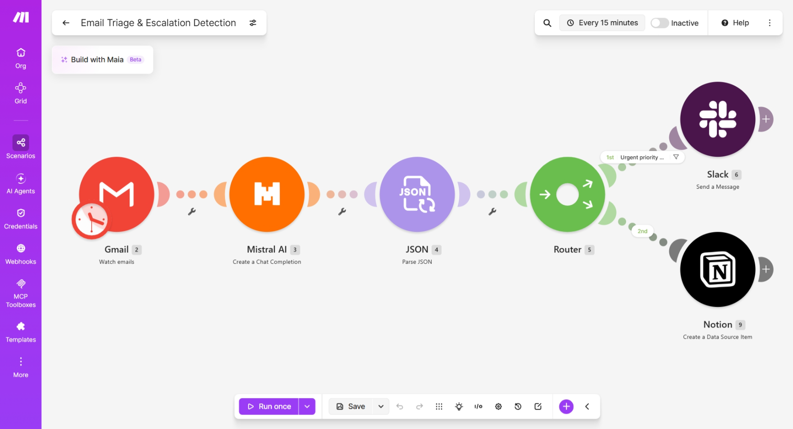

# Email Triage & Escalation Detection

A scenario that reads incoming support emails, uses an AI model (Mistral) to decide their real priority and escalation risk, logs every email in Notion, and alerts your team on Slack when an email is urgent.

▶️ **Video tutorial:** [watch on YouTube](https://www.youtube.com/watch?v=KgRLsqSFJVY)

[](https://www.youtube.com/watch?v=KgRLsqSFJVY)

## The scenario



```
Gmail (new email) ──► Mistral AI (triage as JSON) ──► Parse JSON ──► Router
                                                                      ├─► Urgent only ──► Slack (alert)
                                                                      └─► All emails ──► Notion (log)
```

## What it does

1. **Watch new emails** (Gmail): checks your inbox for new messages.
2. **Triage the email** (Mistral AI, `mistral-medium-latest`): sends the email to the model with a system prompt (see [`prompt.md`](prompt.md)). The model looks at four signal categories (business risk, time urgency, security, escalation pattern) and ignores the sender's own importance flag. It returns:
   - `Priority`: `Urgent` (explicit same-day deadline, active lockout, ultimatum with a date), `High` (real risk without an immediate deadline) or `Normal`
   - `EscalationRisk`: `High`, `Medium` or `Low`
   - `Reason`: one sentence naming the signal detected
   - `SignalCategory`: `Business risk`, `Time urgency`, `Security`, `Escalation pattern` or `None`
3. **Parse JSON**: turns the model's reply into structured data.
4. **Slack alert**: for `Urgent` emails only, posts the subject, priority, reason and original email in a channel.
5. **Notion log**: adds every email to a Notion database.

> **The AI can make mistakes.** It can rate an urgent email as `Normal` or the other way round. Don't let it be the only filter: keep an eye on emails marked `Normal` too, especially at the start.

## Requirements

- A Make.com account (the free plan is enough to try it)
- A Gmail account
- A Mistral AI API key ([console.mistral.ai](https://console.mistral.ai))
- A Notion workspace
- A Slack workspace

## Notion database setup

Create a database with these properties:

| Property        | Type   | Filled with                 |
|-----------------|--------|-----------------------------|
| Subject         | Title  | Email subject               |
| Sender          | Text   | Sender name                 |
| Date            | Date   | Date the email was received |
| Priority        | Select | `Priority` from the AI      |
| Escalation Risk | Select | `EscalationRisk` from the AI |
| Signal Category | Select | `SignalCategory` from the AI |
| Reason          | Text   | `Reason` from the AI        |
| Original Email  | Text   | Email body                  |

## Installation

1. Download [`Email Triage & Escalation Detection.blueprint.json`](Email%20Triage%20%26%20Escalation%20Detection.blueprint.json).
2. In Make, create a new scenario, open the **⋯** menu, choose **Import Blueprint** and select the file.
3. Reconnect each module to your own accounts:
   - **Gmail**: add your connection.
   - **Mistral AI**: add a connection with your API key.
   - **Slack**: add your connection and pick **your** channel.
   - **Notion**: add your connection, then pick **your** database and check the field mapping.
4. In the **Parse JSON** module, rebuild the data structure if Make asks for it.
5. Click **Run once** and send yourself a test email, for example:
   > This is the third time I'm asking: our account is locked and the team can't work. If this isn't fixed by 5 pm today, we'll cancel our contract.
6. Turn on scheduling when you are happy with the result.

## Customizing

- **Priority rules**: change the signals and the calibration in the Mistral module. [`prompt.md`](prompt.md) has a readable copy.
- **Model**: any Mistral model works. A lower `temperature` (for example `0.2`) gives more consistent triage.
- **Alerts**: also alert on `High` priority, or send the alert by email or SMS.
- **Email filter**: limit the Gmail trigger to your support inbox or a label.

## Privacy and security

- **Email contents are sent to Mistral AI** for processing, and **copied to Notion and Slack**. Only use this with mailboxes whose data you are allowed to share with these services.
- **API keys and OAuth tokens stay in your Make connections** and are never exported in the blueprint.
- **Emails are untrusted input.** Someone could write an email designed to trick the AI (prompt injection) into raising or lowering its priority.

## License

[MIT](LICENSE)
